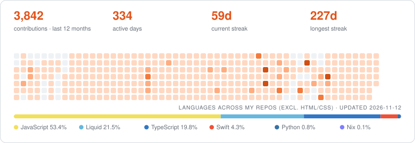

<picture>
  <source media="(prefers-color-scheme: dark)" srcset="assets/header-dark.svg">
  
</picture>

I write SwiftUI for a living and build my own products on the side. By day I work on travel apps at
[@Lascade-co](https://github.com/Lascade-co). After hours I ship data pipelines, websites and the small
SwiftUI components I wish already existed.

### What I'm building now

|  |  |
|---|---|
| 📈 **BeyondApps** | An app-intelligence product that archives App Store chart rankings every day and shows how each trend number is calculated. It runs on a TypeScript pipeline, Postgres and Next.js. *Private for now; launching soon.* |
| ✨ **[Zelcodes](https://akashkottil.github.io/zelcodes-web/)** | A library of production-ready SwiftUI animations, transitions and UI effects, with a showcase site built in Next.js and Framer Motion. |
| 🧩 **[Zelexto Studio](https://github.com/zelexto)** | Web experiences built to stand out: landing pages, Shopify themes and a set of café site templates. |

### Shipped at work

Apps I've built and maintain at Lascade, all native SwiftUI:

### Open-source SwiftUI bits

Small, copy-paste-friendly fixes for things SwiftUI makes harder than they should be. *(Refreshes daily.)*

<!-- OSS:start -->
| Repo | What it does | Stars |
|---|---|---|
| [**swipeback-gesture-in-custom-navbar-swiftUI**](https://github.com/akashkottil/swipeback-gesture-in-custom-navbar-swiftUI) | A complete SwiftUI solution for implementing custom navigation bar back buttons while preserving the native… | ★ 9 |
| [**masonry-layout-swiftui**](https://github.com/akashkottil/masonry-layout-swiftui) | A reusable, responsive Pinterest-style masonry grid for SwiftUI, with configurable columns and variable-hei… | ★ 6 |
| [**MarqueeText**](https://github.com/akashkottil/MarqueeText) | A lightweight SwiftUI marquee: long text scrolls horizontally only when it overflows. Handy for tickers and… | ★ 4 |
| [**View-HideTabBar-Swift**](https://github.com/akashkottil/View-HideTabBar-Swift) | A tiny SwiftUI helper that hides the Tab Bar only on specific pushed screens—so your detail pages (like Cou… | ★ 2 |
| [**Network-Logger**](https://github.com/akashkottil/Network-Logger) | Network Logger / cURL Logger for iOS / Swift / Alamofire  This is a lightweight Swift library / utility to… | ★ 1 |
| [**matched-geometry-collapse-Demo**](https://github.com/akashkottil/matched-geometry-collapse-Demo) | A tiny SwiftUI demo that shows how to build a sticky, collapsible header whose content morphs and moves as… | ★ 1 |
<!-- OSS:end -->

### Activity

<picture>
  <source media="(prefers-color-scheme: dark)" srcset="assets/activity-dark.svg">
  
</picture>

<b>Recent public activity</b> (refreshes daily; most of my work is in private repos)

<!-- RECENT:start -->
- 🔨 Pushed to [zelcodes-io/zelcodes-io.github.io](https://github.com/zelcodes-io/zelcodes-io.github.io) · yesterday
- 🔨 Pushed to [akashkottil/Zelcodes-Graphic_Designer](https://github.com/akashkottil/Zelcodes-Graphic_Designer) · yesterday
- 🔨 Pushed to [akashkottil/zelexto-landing](https://github.com/akashkottil/zelexto-landing) · 6 days ago
- 🔨 Pushed to [akashkottil/akashkottil](https://github.com/akashkottil/akashkottil) · 6 days ago
- 🔀 Opened a PR in [akashkottil/zelexto-landing](https://github.com/akashkottil/zelexto-landing) · 6 days ago
<!-- RECENT:end -->

### Tools I use

### Say hi

The cards and lists here are generated by [a small script](scripts/update.mjs) that runs every day. No third-party stats services.
